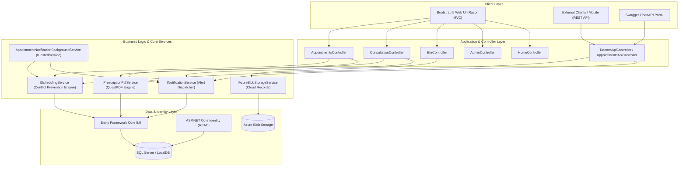
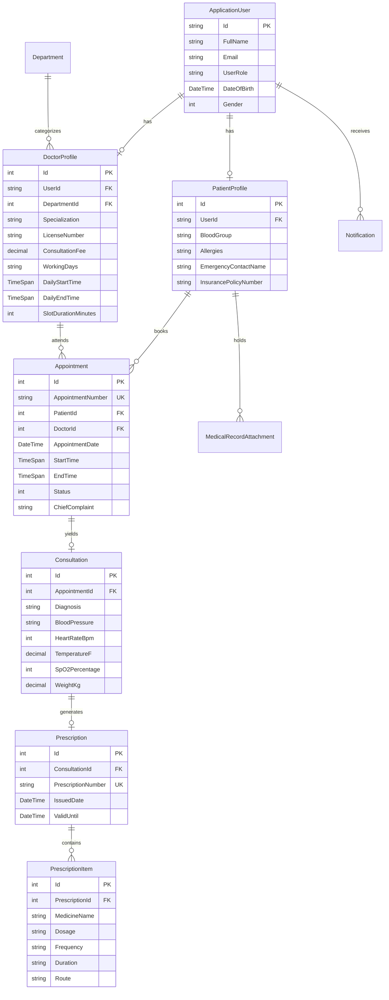

# 🏥 CarePulse – Healthcare & Clinical Appointment System
> **HealthTech Solution 04 // CLINICAL**  
> **Smart Doctor Scheduling, Electronic Health Records (EHR) & Clinical Workflows**

[](https://dotnet.microsoft.com/)
[](https://learn.microsoft.com/en-us/dotnet/csharp/)
[](https://dotnet.microsoft.com/apps/aspnet)
[](https://learn.microsoft.com/en-us/ef/core/)
[](https://www.microsoft.com/sql-server)
[](https://azure.microsoft.com/)
[](https://getbootstrap.com/)
[](https://swagger.io/)

---

## 📌 Executive Summary

**CarePulse** is an enterprise-grade healthcare management and clinical scheduling solution designed to resolve real-world outpatient clinical congestion. Built with **C#**, **ASP.NET Core 9.0 MVC**, **Entity Framework Core**, **SQL Server**, and **Azure Services**, CarePulse unifies smart physician availability calendars, patient electronic health records (EHR), automated digital prescription generation with exportable PDF summaries, and proactive background notification services.

---

## 🌟 Key Architectural Features

### 1. 📅 Smart Doctor Scheduling & Conflict Prevention
- **Real-Time Availability Calendars**: Computes doctor consultation slots dynamically based on active working days, daily consultation hours, and configurable slot intervals (e.g. 30 minutes).
- **Zero Double-Booking Algorithm**:
  - Validates potential appointment slots against existing non-cancelled bookings.
  - Multi-doctor conflict detection preventing the same patient from reserving concurrent consultations with different physicians.
  - Past-time rejection and working-day constraint verification.
- **Interactive UI Slot Picker**: Async RESTful integration fetching real-time slot states (`Available`, `Reserved`, `Time Passed`).

### 2. 🛡️ Secure Electronic Health Record (EHR) & Strict RBAC
- **Role-Based Access Control (RBAC)** across three personas:
  - **Patient**: Self-service portal to book appointments, review visit history, view vital trends, and download digital prescriptions. Patient data isolation ensures users can access only their own medical records.
  - **Doctor**: Clinical workspace to view scheduled patients, log vitals, record diagnostic findings (with ICD descriptions), issue digital prescriptions, and review historical EHR documents.
  - **Admin**: Central command dashboard monitoring clinic-wide KPIs, practitioner rosters, operational hours, department configurations, and system audit trails.
- **Clinical Attachments**: Secure storage for diagnostic radiology scans (CT, X-Ray, MRI) and laboratory reports.

### 3. ℞ Automated Digital Prescriptions & QuestPDF Generation
- **Physician Workspace**: Dynamic multi-item prescription builder allowing physicians to specify medicine name, formulation, dosage, frequency (e.g., `1-0-1 After Meals`), duration, and administration route.
- **Exportable PDF Clinical Summaries**: Integrated **QuestPDF** engine producing high-resolution, pixel-perfect, tamper-evident medical summary PDFs featuring:
  - Clinic and department branding headers with contact numbers.
  - Attending physician qualification, specialization, and license number.
  - Patient baseline (Age, Gender, Blood Group, and prominent Allergy Warnings).
  - Recorded physical examination and vitals (BP, Heart Rate, Temp, SpO2, Weight).
  - Medication schedule table with formatted Rx styling.
  - Electronic verification badges and doctor signature stamps.

### 4. 🔔 Integrated Background Notification Services
- **`AppointmentNotificationBackgroundService` (`IHostedService`)**:
  - Periodically scans for upcoming confirmed clinical visits within the next 24-48 hours.
  - Automatically dispatches reminders to patients and attending physicians.
  - Triggers instant notifications on appointment booking, schedule alterations, and cancellations.
  - In-app notification center with read/unread tracking and direct quick-links.

### 5. ☁️ Azure Cloud & Hybrid Storage Integration
- **Azure Blob Storage**: Production-ready `AzureBlobStorageService` integrating `Azure.Storage.Blobs` to store sensitive diagnostic imaging and test reports securely in Azure cloud containers.
- **Resilient Fallback**: Gracefully falls back to local storage when running in offline or self-hosted developer environments without an Azure subscription.

### 6. 🔌 RESTful Web API & Swagger Documentation
- Documented REST endpoints conforming to modern OpenAPI / Swagger v1 standards:
  - `GET /api/v1/doctors` &mdash; List certified specialists and fees.
  - `GET /api/v1/doctors/{id}/availability?date=YYYY-MM-DD` &mdash; Query real-time time slots and availability status.
  - `GET /api/v1/appointments/{id}` & `POST /api/v1/appointments` &mdash; Programmatic booking with conflict validation.
  - `GET /api/v1/ehr/patients/{id}` &mdash; Clinical health record and consultation data endpoint.

---

## 🏛️ System Architecture



---

## 📊 Database Entity-Relationship Model



---

## 🔑 Pre-Seeded Demo Credentials

The application initializes with realistic seed data, doctor rosters, patient histories, and consultations out-of-the-box:

| Role | Email | Password | Description |
| :--- | :--- | :--- | :--- |
| **Admin** | `admin@carepulse.com` | `Admin@123` | Chief Medical Officer (Full clinic dashboard, doctor status control) |
| **Doctor** | `doctor.meredith@carepulse.com` | `Doctor@123` | Attending Physician &bull; General Internal Medicine |
| **Doctor** | `doctor.carter@carepulse.com` | `Doctor@123` | Attending Physician &bull; Cardiology |
| **Doctor** | `doctor.watson@carepulse.com` | `Doctor@123` | Attending Physician &bull; Neurology |
| **Doctor** | `doctor.clara@carepulse.com` | `Doctor@123` | Attending Physician &bull; Pediatrics |
| **Patient** | `patient.bruce@carepulse.com` | `Patient@123` | Registered Patient &bull; Has past consultation & EHR records |
| **Patient** | `patient.diana@carepulse.com` | `Patient@123` | Registered Patient &bull; Has active today appointment |

> 💡 **Tip**: The Sign-In screen features a **1-Click Demo Login** bar that autofills these credentials instantly for review.

---

## 🚀 Getting Started

### Prerequisites
- [.NET 9.0 SDK](https://dotnet.microsoft.com/download/dotnet/9.0) (or higher)
- [SQL Server](https://www.microsoft.com/sql-server) or [SQL Server LocalDB](https://learn.microsoft.com/en-us/sql/database-engine/configure-windows/sql-server-express-localdb) *(SQLite is also supported via `appsettings.json`)*
- [Git](https://git-scm.com/)

### 1. Clone the Repository
```bash
git clone https://github.com/YOUR_USERNAME/CarePulse.git
cd CarePulse
```

### 2. Configure Database Connection (Optional)
The default connection string in `appsettings.json` targets your local SQL Server instance:
```json
{
  "DatabaseProvider": "SqlServer",
  "ConnectionStrings": {
    "DefaultConnection": "Server=localhost;Database=CarePulseDb;Trusted_Connection=True;TrustServerCertificate=True;MultipleActiveResultSets=true;",
    "SqliteConnection": "Data Source=CarePulse.db"
  }
}
```
*Note: If you prefer zero database setup, simply change `"DatabaseProvider": "Sqlite"`.*

### 3. Run the Application
```bash
dotnet restore
dotnet build
dotnet run
```
Navigate in your browser to:
- **Web Application**: `http://localhost:5251` (or the port specified in terminal)
- **Interactive Swagger API Docs**: `http://localhost:5251/swagger`

*On initial startup, `DbInitializer` automatically creates the database schema, sets up roles, and seeds practitioners, departments, patient records, and digital prescriptions.*

---

## 📖 RESTful API Overview

| Method | Endpoint | Description |
| :--- | :--- | :--- |
| `GET` | `/api/v1/doctors` | List all available doctors and departments |
| `GET` | `/api/v1/doctors/{id}` | Retrieve individual physician details |
| `GET` | `/api/v1/doctors/{id}/availability?date=YYYY-MM-DD` | Real-time time slot availability calculation |
| `GET` | `/api/v1/appointments/{id}` | Get appointment status and booking info |
| `POST` | `/api/v1/appointments` | Book new appointment with conflict checking |
| `POST` | `/api/v1/appointments/{id}/cancel` | Cancel an active appointment |
| `GET` | `/api/v1/ehr/patients/{patientId}` | Access patient EHR, vitals, prescriptions |

---

## 📤 Uploading to GitHub

Follow these steps to upload this complete codebase to your GitHub account:

```bash
# 1. Initialize Git repository
git init

# 2. Add all files
git add .

# 3. Create initial commit
git commit -m "feat: initial commit - CarePulse healthcare & clinical appointment system"

# 4. Rename main branch
git branch -M main

# 5. Connect to your GitHub repository
git remote add origin https://github.com/YOUR_USERNAME/CarePulse.git

# 6. Push to GitHub
git push -u origin main
```

---

## 🛡️ License & Compliance
This software is built for healthcare demonstration and clinical workflow management under the MIT License. Designed following standard Role-Based Access Control and electronic medical record protection principles.
